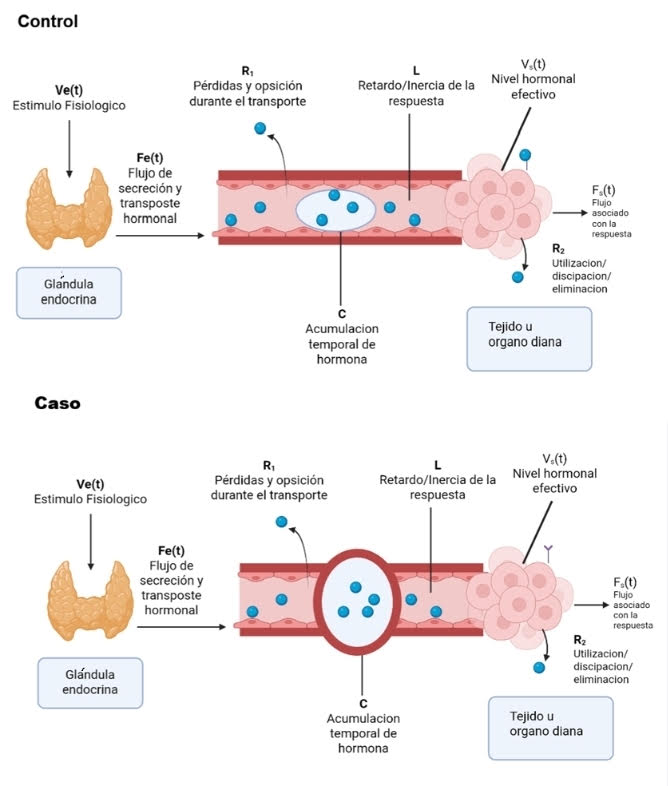
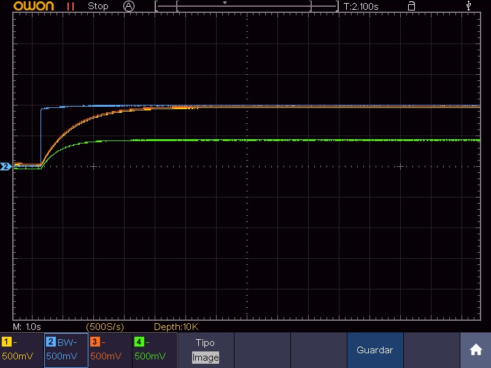
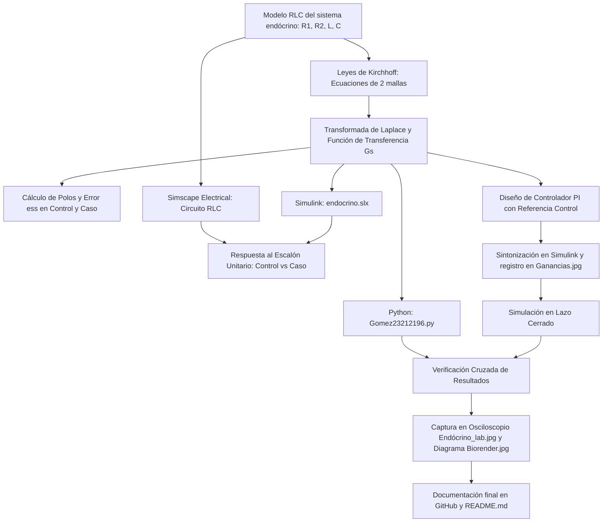

[](https://matlab.mathworks.com/open/github/v1?repo=EmiCrack132/MSFP4)

# Práctica 4: Modelado y control del sistema endócrino

Repositorio académico de la asignatura **Modelado de Sistemas Fisiológicos**, correspondiente al programa de **Ingeniería Biomédica** del Tecnológico Nacional de México / Instituto Tecnológico de Tijuana. Esta práctica integra el modelado eléctrico de segundo orden mediante un circuito RLC, la deducción analítica de ecuaciones integro-diferenciales y función de transferencia, el análisis de estabilidad en lazo abierto, la simulación computacional *in silico* (MATLAB, Simulink, Simscape y Python), la verificación experimental en osciloscopio y el diseño de un controlador PI para la compensación de alteraciones en el sistema endócrino.

El caso de estudio representa la **dinámica de regulación hormonal del sistema endócrino** mediante un circuito eléctrico equivalente $R_1 R_2 L C$ de dos mallas. Se compara la respuesta fisiológica en un individuo sano (**Control**) frente a una condición de disfunción endócrina (**Caso**), implementando un controlador PI en lazo cerrado que corrige el error en estado estacionario y recupera la trayectoria normal.

**Docente:** Dr. Paul Antonio Valle Trujillo  
**Correo:** paul.valle@tectijuana.edu.mx · paul.vt@tijuana.tecnm.mx  
**Departamento:** Ingeniería Eléctrica y Electrónica  
**Institución:** Tecnológico Nacional de México / Instituto Tecnológico de Tijuana  
**Asignatura:** Modelado de Sistemas Fisiológicos (IBF-1020)  
**Programa:** Ingeniería Biomédica  
**Estudiante:** Emiliano Gómez Quiroa · 23212196 · l23212196@tijuana.tecnm.mx  

**Repositorio de la asignatura:** https://github.com/DrPaulValle/MSF-IBF1020  
**Repositorio del proyecto:** https://github.com/EmiCrack132/MSFP4  
**Sede:** Blvd. Alberto Limón Padilla s/n, Tijuana, C. P. 22454, B. C., México.

---

<a id="contenido"></a>
## Contenido

1. [Resumen](#resumen)
2. [Competencia y objetivos](#objetivos)
3. [Relación con el temario](#temario)
4. [Modelo físico y analogía electromecánica](#analogia)
5. [Formulación matemática](#modelo)
6. [Análisis temporal y de estabilidad](#analisis)
7. [Señales de entrada y condiciones de simulación](#senales)
8. [Implementación en MATLAB, Simulink y Simscape](#matlab)
9. [Control en lazo cerrado y sintonización PI](#PI)
10. [Reproducción en Python](#python)
11. [Resultados y verificación cruzada](#resultados)
12. [Flujo de trabajo](#flujo)
13. [Actividades del estudiante](#actividades)
14. [Estructura del repositorio](#estructura)
15. [Requisitos](#requisitos)
16. [Reproducibilidad y entregables](#reproducibilidad)
17. [Referencias](#referencias)

---

<a id="resumen"></a>
## Resumen

La práctica tuvo como propósito **modelar, analizar y controlar la respuesta dinámica del sistema endócrino** mediante experimentación *in silico* y validación experimental. La regulación glandular y hormonal se representó mediante un **circuito RLC** de dos mallas compuesto por una resistencia de entrada ($R_1$), un capacitor en derivación ($C$), una inductancia ($L$) y una resistencia de carga ($R_2$).

A partir de las leyes de Kirchhoff se formularon las ecuaciones integro-diferenciales del sistema y se obtuvo su función de transferencia de segundo orden $G(s) = \frac{V_s(s)}{V_e(s)}$. Ante una excitación de **escalón unitario**, se evaluó la ubicación de los polos y el error en estado estacionario en condición normal (**Control**, $e_{ss} = 0.0099$) frente a una alteración endócrina (**Caso**, $e_{ss} = 0.5$), caracterizada por un incremento en la capacitancia $C$ y una disminución en la resistencia $R_2$. Finalmente, se sintonizó e implementó un **controlador PI con retroalimentación negativa** para compensar la respuesta del caso patológico, verificando la consistencia entre MATLAB/Simulink, Simscape Electrical, Python y la medición física en osciloscopio.

**Palabras clave:** Circuito RLC; Controlador PI; Sistema endócrino; Modelo matemático; Simulaciones numéricas.

[Volver al contenido](#contenido)

---

<a id="objetivos"></a>
## Competencia y objetivos

### Competencia a desarrollar

Modelizar sistemas fisiológicos mediante analogías entre sistemas físicos, ecuaciones diferenciales y funciones de transferencia para analizar su comportamiento dinámico y diseñar estrategias de control mediante técnicas de control clásico. En particular, analizar un modelo eléctrico de segundo orden del sistema endócrino, comparar la respuesta de un individuo sano (control) con un caso simulado de disfunción endócrina (caso) y diseñar una estrategia de control PI *in silico* orientada a eliminar las diferencias entre ambas respuestas.

### Objetivo general

Formular el modelo matemático del sistema endócrino mediante un circuito eléctrico equivalente $R_1 R_2 L C$, simular su respuesta dinámica en lazo abierto ante una entrada escalón unitario para condiciones de salud y patología, y diseñar un sistema de control PI en lazo cerrado que compense la alteración fisiológica.

### Objetivos específicos

- Plantear las ecuaciones integro-diferenciales de dos mallas del circuito RLC equivalente del sistema endócrino.
- Derivar analíticamente la función de transferencia $G(s) = \frac{V_s(s)}{V_e(s)}$ en el dominio de Laplace.
- Evaluar la ubicación de las raíces características ($\lambda_1, \lambda_2$), el amortiguamiento y el error en estado estacionario ($e_{ss}$) para Control y Caso.
- Implementar y simular ambas condiciones en MATLAB, Simulink y Simscape Electrical (`endocrino.slx`) ante una entrada escalón unitario.
- Sintonizar las ganancias ($k_P, k_I$) de un controlador PI que elimine el error en estado estacionario del Caso patológico.
- Reproducir el comportamiento dinámico en lazo abierto y lazo cerrado mediante el script de Python `Gomez23212196.py`.
- Elaborar el esquema fisiológico en BioRender (`Biorender.jpg`) y registrar la respuesta experimental del circuito mediante captura de osciloscopio (`Endócrino_lab.jpg`).

[Volver al contenido](#contenido)

---

<a id="temario"></a>
## Relación con el temario

La práctica integró contenidos correspondientes a las unidades temáticas de la asignatura **Modelado de Sistemas Fisiológicos (IBF-1020)**:

| Unidad | Área | Contenidos aplicados |
|---|---|---|
| I | Sistemas de control retroalimentados | Diagramas de bloques, respuesta al escalón unitario, error en estado estacionario ($e_{ss}$) y análisis de estabilidad mediante polos |
| II | Modelado matemático | Modelado de circuitos RLC de dos mallas, ecuaciones integro-diferenciales y funciones de transferencia de segundo orden |
| III | Controladores | Controladores PI, sintonización de ganancias y sistemas de compensación *in silico* |

[Volver al contenido](#contenido)

---

<a id="analogia"></a>
## Modelo físico y analogía electromecánica

<p align="center">
  
  <br>
  <em>Figura 1: Esquema fisiológico y circuito equivalente del sistema endócrino diseñado en BioRender.</em>
</p>

El sistema endócrino se modeló mediante un circuito eléctrico de dos mallas con corrientes $i_1(t)$ e $i_2(t)$, excitado por una fuente de voltaje $V_e(t)$ en serie con $R_1$, un capacitor $C$ en derivación entre ambas mallas, y una rama de salida formada por el inductor $L$ en serie con la resistencia $R_2$, donde se mide la respuesta $V_s(t)$.

### Equivalencias del circuito RLC con el sistema endócrino

| Variable / Elemento eléctrico | Interpretación fisiológica en el sistema endócrino |
|---|---|
| Voltaje de entrada $V_e(t)$ | Estímulo secretor o señal reguladora glandular |
| Voltaje de salida $V_s(t)$ | Concentración plasmática hormonal / respuesta efectora |
| Corrientes de malla $i_1(t), i_2(t)$ | Flujos de secreción y distribución hormonal |
| Resistencia $R_1$ | Resistencia a la secreción y transporte inicial |
| Capacitor $C$ | Capacidad de almacenamiento y volumen de distribución hormonal |
| Inductor $L$ | Inercia metabólica y retardo en la dinámica de respuesta |
| Resistencia $R_2$ | Sensibilidad de receptores y tasa de depuración hormonal |

### Parámetros para la simulación *in silico*

| Parámetro | Control (Sano) | Caso (Disfunción Endócrina) | Unidad | Interpretación fisiológica |
|---|---:|---:|---|---|
| $R_1$ | $1\,\mathrm{k}$ ($1000$) | $1\,\mathrm{k}$ ($1000$) | $\Omega$ | Resistencia de secreción inicial |
| $R_2$ | $100\,\mathrm{k}$ ($100\,000$) | $1\,\mathrm{k}$ ($1000$) | $\Omega$ | Resistencia de carga / sensibilidad efectora |
| $L$ | $100\,\mathrm{m}$ ($0.1$) | $100\,\mathrm{m}$ ($0.1$) | $\mathrm{H}$ | Inercia dinámica del eje endócrino |
| $C$ | $1\,\mu$ ($1\times 10^{-6}$) | $1000\,\mu$ ($1\times 10^{-3}$) | $\mathrm{F}$ | Capacitancia de almacenamiento hormonal |

La alteración endócrina (**Caso**) se simuló mediante un aumento de tres órdenes de magnitud en la capacitancia ($C = 1\,\mu\mathrm{F} \to 1000\,\mu\mathrm{F}$) y una reducción en la resistencia de carga ($R_2 = 100\,\mathrm{k}\Omega \to 1\,\mathrm{k}\Omega$), provocando una caída del $50\%$ en la amplitud de estado estacionario y una respuesta notablemente más lenta.

[Volver al contenido](#contenido)

---

<a id="modelo"></a>
## Formulación matemática

La deducción analítica completa del modelo de dos mallas se encuentra documentada en `Análisis matemático P4.pdf`.

### 1. Ecuaciones integro-diferenciales del sistema

Aplicando la Ley de Voltajes de Kirchhoff en ambas mallas y definiendo el voltaje de salida $V_s(t)$ en la rama de $L$ y $R_2$:

$$V_e(t) = R_1 i_1(t) + \frac{1}{C} \int \left(i_1(t) - i_2(t)\right) dt$$

$$L \frac{d i_2(t)}{dt} + R_2 i_2(t) = \frac{1}{C} \int \left(i_1(t) - i_2(t)\right) dt$$

$$V_s(t) = L \frac{d i_2(t)}{dt} + R_2 i_2(t)$$

Despejando las corrientes $i_1(t)$ e $i_2(t)$ para su implementación por bloques en Simulink:

$$i_1(t) = \frac{1}{R_1} \left[ V_e(t) - \frac{1}{C} \int \left(i_1(t) - i_2(t)\right) dt \right]$$

$$i_2(t) = \frac{1}{R_2} \left[ \frac{1}{C} \int \left(i_1(t) - i_2(t)\right) dt - L \frac{d i_2(t)}{dt} \right]$$

### 2. Función de transferencia en el dominio de Laplace

Aplicando la transformada de Laplace con condiciones iniciales nulas:

$$V_e(s) = \left(R_1 + \frac{1}{Cs}\right) I_1(s) - \frac{1}{Cs} I_2(s)$$

$$I_1(s) = \left(C L s^2 + C R_2 s + 1\right) I_2(s)$$

$$V_s(s) = \left(L s + R_2\right) I_2(s)$$

Sustituyendo $I_1(s)$ y relacionando la salida $V_s(s)$ con la entrada $V_e(s)$, se obtiene la función de transferencia del sistema endócrino:

$$\boxed{G(s) = \frac{V_s(s)}{V_e(s)} = \frac{L s + R_2}{(R_1 C L) s^2 + (R_1 R_2 C + L) s + R_1 + R_2}}$$

[Volver al contenido](#contenido)

---

<a id="analisis"></a>
## Análisis temporal y de estabilidad

### 1. Ubicación de polos y estabilidad en lazo abierto

El polinomio característico del denominador está dado por:

$$(R_1 C L) s^2 + (R_1 R_2 C + L) s + (R_1 + R_2) = 0$$

Evaluando las raíces para ambas condiciones fisiológicas:

- **Control (Sano):**

$$\lambda_1 = -1010.0101, \qquad \lambda_2 = -999\,989.9899$$

Al poseer dos polos reales distintos y estrictamente negativos ($\mathrm{Re}(\lambda_{1,2}) < 0$), el sistema es **estable con respuesta sobreamortiguada**.

- **Caso (Disfunción Endócrina):**

$$\lambda_1 = -2.0002, \qquad \lambda_2 = -9998.9998$$

El sistema permanece **estable con respuesta sobreamortiguada**, pero el polo dominante ($\lambda_1 = -2.0002$) se desplaza significativamente hacia el origen, volviendo mucho más lenta la dinámica hormonal.

### 2. Error en estado estacionario ($e_{ss}$)

Ante una entrada escalón unitario $V_e(s) = \frac{1}{s}$, aplicando el Teorema del Valor Final:

$$e_{ss} = \lim_{s \to 0} s V_e(s) \left[1 - G(s)\right] = 1 - \frac{R_2}{R_1 + R_2}$$

- **Error en Control:**

$$e_{ss} = 1 - \frac{100\,000}{1000 + 100\,000} = 0.0099 \quad $$

- **Error en Caso:**

$$e_{ss} = 1 - \frac{1000}{1000 + 1000} = 0.5 \quad $$

[Volver al contenido](#contenido)

---

<a id="senales"></a>
## Señales de entrada y condiciones de simulación

- **Entrada nominal:** Señal **escalón unitario** $V_e(t) = u(t)$ ($1\,\mathrm{V}$, $V_e(s) = \frac{1}{s}$) aplicada al circuito RLC equivalente.
- **Criterio de error a compensar:** $e(t) = V_{s, \text{control}}(t) - V_{s, \text{caso}}(t)$.

[Volver al contenido](#contenido)

---

<a id="matlab"></a>
## Implementación en MATLAB, Simulink y Simscape

Se construyeron e implementaron las representaciones equivalentes del sistema en lazo abierto y lazo cerrado dentro del archivo `endocrino.slx`:

1. **Ecuaciones integro-diferenciales:** Bloques de suma, ganancia, integradores y derivadores en Simulink.
2. **Función de transferencia:** Bloque `Transfer Fcn` evaluando $G(s) = \frac{L s + R_2}{(R_1 C L) s^2 + (R_1 R_2 C + L) s + R_1 + R_2}$.

El cuaderno computacional `Gomez23212196.mlx` ejecuta las simulaciones, extrae las variables al *Workspace* y exporta los resultados a `Gomez23212196.pdf` y `Endócrino_matlab.pdf`.

[Volver al contenido](#contenido)

---

<a id="PI"></a>
## Control en lazo cerrado y sintonización PI

### 1. Esquema de control

Se diseñó una estructura de control retroalimentada donde la respuesta del individuo sano $V_s(t): \text{Control}$ actúa como referencia para compensar la dinámica del caso patológico:


### 2. Sintonización de ganancias

Mediante la herramienta **Tune** del bloque `PI Controller` en Simulink, se sintonizaron las ganancias del controlador para el modelo patológico (registradas en `Ganancias.jpg`):

- Ganancia Proporcional ($k_P$): *Valor sintonizado en PI Tune*
- Ganancia Integral ($k_I$): *Valor sintonizado en PI Tune*

El controlador PI implementado obliga al sistema patológico a eliminar por completo el error en estado estacionario del $50\%$ presente en el **Caso**, logrando que la salida del tratamiento siga la trayectoria de referencia.

[Volver al contenido](#contenido)

---

<a id="python"></a>
## Reproducción en Python

Mediante el script independiente en Python (`Gomez23212196.py`) y las librerías `scipy.signal`, `matplotlib` y `control`, se realizó la simulación numérica para verificar los resultados obtenidos en MATLAB/Simulink:

1. Definición de las funciones de transferencia $G_{\text{control}}(s)$ y $G_{\text{caso}}(s)$.
2. Simulación de la respuesta al escalón unitario ante la señal de entrada $V_e(t)$.
3. Implementación del lazo cerrado con las ganancias $k_P$ y $k_I$ sintonizadas.
4. Exportación gráfica a `Endócrino_python.pdf`.

[Volver al contenido](#contenido)

---

<a id="resultados"></a>
## Resultados y verificación cruzada

En los archivos `Endócrino_matlab.pdf` y `Endócrino_python.pdf` se presentan de forma comparativa las señales del sistema:

- **Señal de entrada $V_e(t)$:** Escalón unitario aplicado al sistema endócrino.
- **Respuesta de Control $V_s(t)$:** Comportamiento dinámico del individuo sano, alcanzando prácticamente el valor de referencia ($e_{ss} = 0.0099$).
- **Respuesta de Caso $V_s(t)$:** Respuesta del sistema con disfunción endócrina en lazo abierto, evidenciando una atenuación severa ($e_{ss} = 0.5$) y una respuesta transitoria lenta.
- **Tratamiento PI:** Respuesta del sistema patológico compensado en lazo cerrado, eliminando el error estacionario y superponiéndose a la respuesta de Control.

<p align="center">
  
  <br>
  <em>Figura 2: Validación experimental de la respuesta dinámica del circuito RLC en el osciloscopio.</em>
</p>

### Archivos de resultados generados

| Condición | MATLAB / Simulink | Python |
|---|---|---|
| Respuesta dinámica y PI | `Endócrino_matlab.pdf` | `Endócrino_python.pdf` |

- Demostración matemática: `Análisis matemático P4.pdf`
- Evidencia de sintonización PI: `Ganancias.jpg`
- Captura experimental en osciloscopio: `Endócrino_lab.jpg`
- Esquema biológico: `Biorender.jpg`

[Volver al contenido](#contenido)

---

<a id="flujo"></a>
## Flujo de trabajo



[Volver al contenido](#contenido)

---

<a id="actividades"></a>
## Actividades del estudiante

### Etapa 1. Formulación analítica

- [x] Plantear las ecuaciones integro-diferenciales de las mallas $i_1(t)$ e $i_2(t)$ del circuito RLC equivalente.
- [x] Obtener la función de transferencia $G(s) = \frac{L s + R_2}{(R_1 C L) s^2 + (R_1 R_2 C + L) s + R_1 + R_2}$ (`Análisis matemático P4.pdf`).
- [x] Calcular los polos ($\lambda_1, \lambda_2$) y el error en estado estacionario ($e_{ss}$) para Control y Caso.

### Etapa 2. Simulación *in silico* de la planta

- [x] Implementar la representación por ecuaciones y función de transferencia en Simulink (`endocrino.slx`).
- [x] Obtener la respuesta temporal al escalón unitario para Control y Caso en lazo abierto.

### Etapa 3. Control PI y compensación

- [x] Configurar el lazo cerrado tomando la respuesta de Control como referencia.
- [x] Sintonizar el controlador PI mediante la herramienta Tune y registrar $k_P, k_I$ en `Ganancias.jpg`.
- [x] Ejecutar el cuaderno de MATLAB (`Gomez23212196.mlx`) y exportar a PDF (`Gomez23212196.pdf` y `Endócrino_matlab.pdf`).
- [x] Reproducir la simulación en Python con el script `Gomez23212196.py` y generar `Endócrino_python.pdf`.

### Etapa 4. Documentación, diagrama biológico y evidencia experimental

- [x] Elaborar el diagrama fisiológico del sistema endócrino en BioRender (`Biorender.jpg`).
- [x] Registrar la respuesta experimental del circuito físico mediante captura de osciloscopio (`Endócrino_lab.jpg`).
- [x] Publicar la versión final en GitHub con los archivos `LICENSE` y `CITATION.cff`.

[Volver al contenido](#contenido)

---

<a id="estructura"></a>
## Estructura del repositorio

```text
.
├── README.md                      # Reporte principal de la práctica
├── CITATION.cff                   # Archivo de citación del repositorio
├── LICENSE                        # Licencia del repositorio
├── Análisis matemático P4.pdf     # Demostración matemática analítica del circuito RLC
├── Biorender.jpg                  # Diagrama fisiológico del sistema endócrino
├── Endócrino_lab.jpg              # Captura de osciloscopio de la respuesta experimental
├── Endócrino_matlab.pdf           # Gráfica de respuesta obtenida en MATLAB
├── Endócrino_python.pdf           # Gráfica de respuesta obtenida en Python
├── Ganancias.jpg                  # Evidencia de sintonización de ganancias PI (PID Tune)
├── Gomez23212196.mlx              # Cuaderno MATLAB de simulación
├── Gomez23212196.pdf              # Exportación en PDF del cuaderno MATLAB
├── Gomez23212196.py               # Script de simulación en Python
└── endocrino.slx                  # Modelo en Simulink / Simscape Electrical
```

[Volver al contenido](#contenido)

---

<a id="requisitos"></a>
## Requisitos

### Software

- **MATLAB** y **Simulink** (con *Control System Toolbox*).
- **Python 3.14** (con librerías `numpy`, `scipy`, `matplotlib`, `control`).
- **Visual Studio Code**.
- **BioRender** (para la elaboración del diagrama biológico `Biorender.jpg`).
- **Git y GitHub**.

[Volver al contenido](#contenido)

---

<a id="reproducibilidad"></a>
## Reproducibilidad y entregables

### Resultados mínimos esperados

| Entregable | Evidencia solicitada |
|---|---|
| Formulación matemática | Ecuaciones de malla, función de transferencia, polos y $e_{ss}$ en `Análisis matemático P4.pdf` |
| Simulación lazo abierto | Comparación gráfica ante escalón unitario entre Control y Caso en `Endócrino_matlab.pdf` |
| Sintonización PI | Ganancias $k_P, k_I$ en `Ganancias.jpg` y gráfico de tratamiento PI |
| Código Python | Script funcional `Gomez23212196.py` y gráfica `Endócrino_python.pdf` |
| Diagrama biológico | Esquema fisiológico del sistema endócrino en `Biorender.jpg` |
| Evidencia experimental | Captura de osciloscopio de la respuesta física en `Endócrino_lab.jpg` |
| Documentación | Repositorio GitHub con `README.md` estructurado, `LICENSE` y `CITATION.cff` |

[Volver al contenido](#contenido)

---

<a id="referencias"></a>
## Referencias

[1] M. C. Khoo, *Physiological Control Systems: Analysis, Simulation, and Estimation*, 2nd ed., IEEE Press, 2018.

[2] F. C. Hoppensteadt y C. S. Peskin, *Modeling and Simulation in Medicine and the Life Sciences*, 2nd ed., Springer, 2002.

[3] J. E. Hall, *Guyton and Hall Textbook of Medical Physiology*, 14th ed., Elsevier, 2021.

[4] K. Ogata, *Ingeniería de Control Moderna*, 5.ª ed., Pearson Educación, 2010.

[5] N. S. Nise, *Control Systems Engineering*, 8th ed., John Wiley & Sons, 2020.

[6] P. A. Valle, *Syllabus para Modelado de Sistemas Fisiológicos*, Tecnológico Nacional de México / Instituto Tecnológico de Tijuana, Tijuana, B. C., México, 2026.

[7] Tecnológico Nacional de México, *Programa de estudio de la asignatura Modelado de Sistemas Fisiológicos, IBF-1020*.

---

## Uso académico

Este repositorio se utiliza como evidencia del desarrollo de la **Práctica 4: Modelado y control del sistema endócrino**. Su objetivo central fue la experimentación *in silico*, la validación en osciloscopio y el análisis de circuitos RLC equivalentes mediante técnicas de control clásico para compensar alteraciones fisiológicas en el sistema endócrino.
